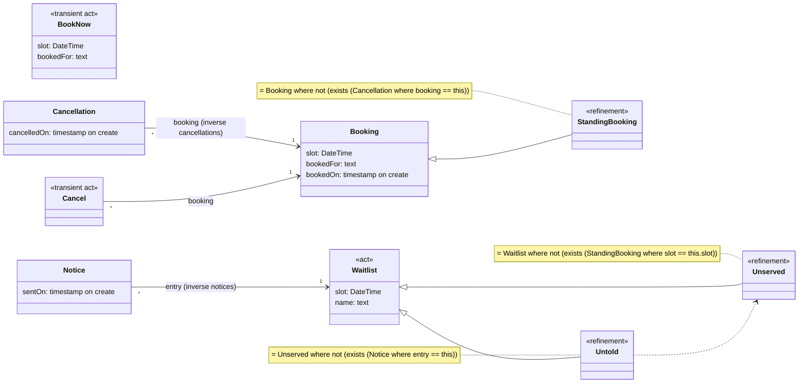
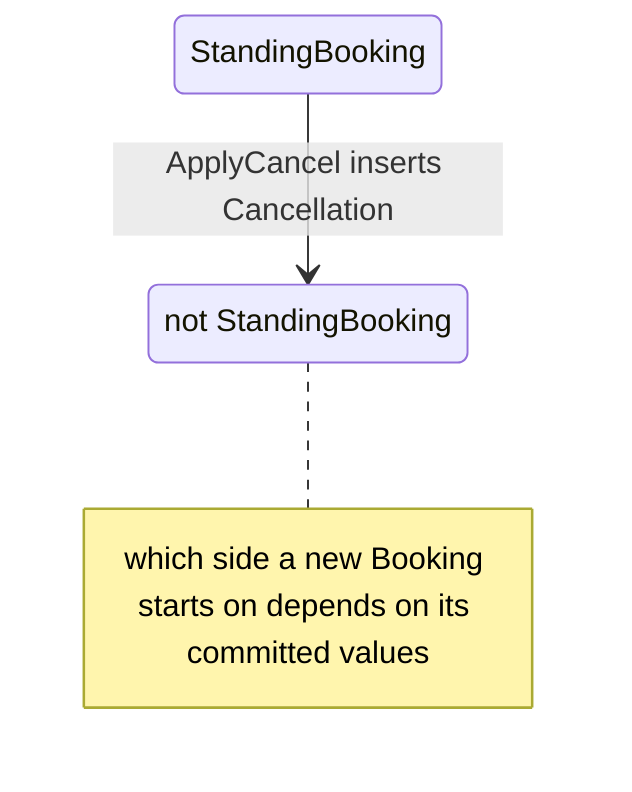
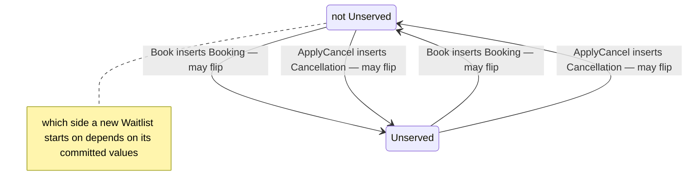
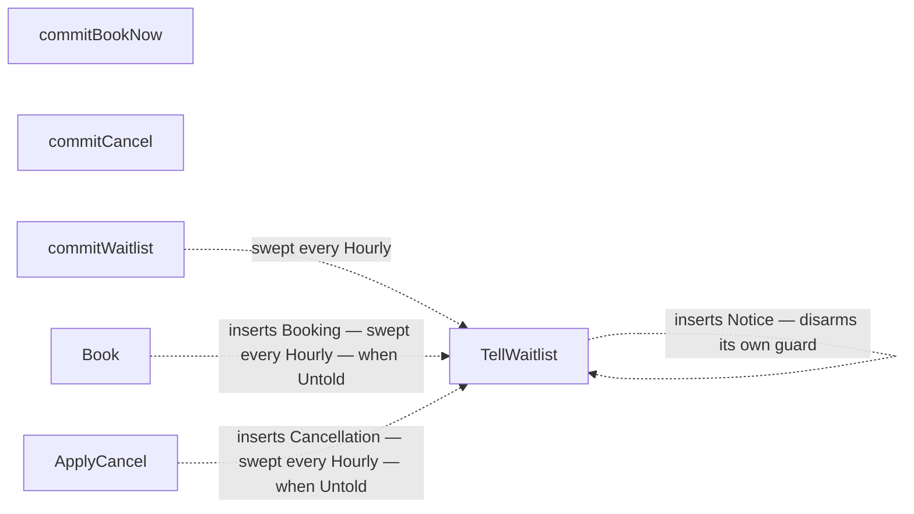

# Diagrams — Bookings

Generated from the spec — a deterministic projection, regenerated by `gradle generate`; do not edit. Every diagram below is derived from the one authored description: the class diagram shows the shapes and their relationships, the state-flow diagrams show each shape's refinement memberships and what can change them, the rule graph maps the whole system's cause-and-effect on one page, and the sequence diagrams show what one act's arrival may cause. None is maintained by hand, so none can drift from the spec or from each other.

## Class diagram

`/name` marks a derived property — computed, never stored. Solid arrows are declared relationships, labeled with the declaring field (and the inferred inverse collection, where one exists). A hollow-triangle arrow reads "is a refinement of": membership is decided by the predicate in the attached note, instant by instant, not fixed at creation. Dashed arrows connect a composed refinement to the refinements it is built from.



## State flow

A state is membership in a refinement, and memberships overlap — so each diagram below is one *axis* of membership, varying independently of its siblings. Arrow directions are proven from the spec (an `exists` can only be satisfied — v0 never deletes — and a fold moves one way when the door-checked prohibitions pin the sign of every contribution); where no proof exists, the edge says **may flip** and is drawn in both directions.

### Booking

**StandingBooking** — may enter and leave.



### Waitlist

- **Untold** = Unserved where not (exists (Notice where entry == this)) — a view composed across the axes below, not an axis of its own.
- **TellWaitlist** — runs at every Hourly tick: when Untold — inserts Notice.

**Unserved** — may enter and leave.



## Rule graph

The whole system on one page: an edge means the source's commit can change the target rule's condition — **may**-cause, like everything else here. Solid edges fire inside the same transaction envelope; dotted edges cross a boundary (`after commit`, or armed now and swept at the labeled tick). Fan-out is not a choice: every edge whose guard holds fires, in no particular order. A diamond appears only where exclusivity is proven — the accept/refuse split of a door-checked `never`, and a transient act's complement partitions. A self-loop marked *disarms its own guard* is the guard-disarm pattern: the rule's own write makes its re-evaluation harmless. An act with no outgoing edge commits quietly — data recorded, no rule woken.



## Contention map

Where the system can work in parallel and where work must wait its turn. Work sharing a **queue key** is handled one item at a time in arrival order (U3), like any queue; work whose keys differ runs independently. A key is evaluated per call — `deposit.account` names the row that call's work queues on. Two envelopes contend iff their key sets intersect: path keys by the row they evaluate to, value keys by equal committed values, and a system-wide row with anything touching its shape. Derived from the spec's own read and write paths — no author declares a queue key.

| envelope | queues on | notes |
|---|---|---|
| commitBookNow | `slot value` | work with equal keys takes turns; different keys run at the same time |
| commitCancel | `cancel.booking`, `slot value` | work with equal keys takes turns; different keys run at the same time |
| commitWaitlist | one queue over `Waitlist`, system-wide | tolerated — never #3: `Waitlist` reads every Waitlist and correlates to no key |
| TellWaitlist (each Hourly firing) | `this`, `slot value` | work with equal keys takes turns; different keys run at the same time |

## Sequence diagrams

One diagram per act. Each diagram is **may-fire**: a rule appears wherever the commit could affect its condition, with the condition shown as a note — whether it actually fires depends on the data at that commit. Frames (`critical`) are transaction envelopes: everything inside one frame stands or falls together.

### commitBookNow

```mermaid
sequenceDiagram
    actor Caller
    participant S as Bookings
    Caller->>S: commitBookNow(slot, bookedFor)
    Note over Caller,S: boundary validation first — type checks, then the door: the prohibitions no rule can move, evaluated over the act's closure before any rule runs; a violation is a refusal and nothing begins
    critical T1 — the BookNow envelope
        S->>S: insert BookNow
        Note over S: transient act — its partitions are decided once, at this commit, and the instance is removed at the envelope's close (only consequences persist)
        Note over S: Book — when BookNow
        S->>S: insert Booking
        Note over S: transaction-end check — never StandingBooking where exists (StandingBooking as other where (other.slot == this.slot) and (not (other == this)))
    end
    S-->>Caller: accepted — or an error anywhere in the frame rolled the whole envelope back
    Note right of S: at each Hourly tick — TellWaitlist sweeps current members of Untold in its own transaction per record
```

### commitCancel

```mermaid
sequenceDiagram
    actor Caller
    participant S as Bookings
    Caller->>S: commitCancel(booking)
    Note over Caller,S: boundary validation first — type checks, then the door: the prohibitions no rule can move, evaluated over the act's closure before any rule runs; a violation is a refusal and nothing begins
    critical T1 — the Cancel envelope
        S->>S: insert Cancel
        Note over S: transient act — its partitions are decided once, at this commit, and the instance is removed at the envelope's close (only consequences persist)
        Note over S: ApplyCancel — when Cancel
        S->>S: insert Cancellation
        Note over S: transaction-end check — never StandingBooking where exists (StandingBooking as other where (other.slot == this.slot) and (not (other == this)))
        Note over S: transaction-end check — never Booking where count(cancellations) > 1
    end
    S-->>Caller: accepted — or an error anywhere in the frame rolled the whole envelope back
    Note right of S: at each Hourly tick — TellWaitlist sweeps current members of Untold in its own transaction per record
```

### commitWaitlist

```mermaid
sequenceDiagram
    actor Caller
    participant S as Bookings
    Caller->>S: commitWaitlist(slot, name)
    Note over Caller,S: boundary validation first — type checks, then the door: the prohibitions no rule can move, evaluated over the act's closure before any rule runs; a violation is a refusal and nothing begins
    critical T1 — the Waitlist envelope
        S->>S: insert Waitlist
        Note over S: no rules fire inside this envelope
        Note over S: transaction-end check — never Waitlist where count(Waitlist) > 20
    end
    S-->>Caller: accepted — or an error anywhere in the frame rolled the whole envelope back
    Note right of S: at each Hourly tick — TellWaitlist sweeps current members of Untold in its own transaction per record
```
